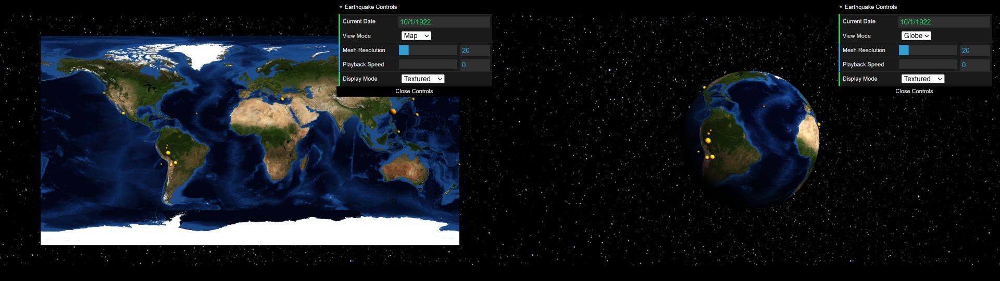
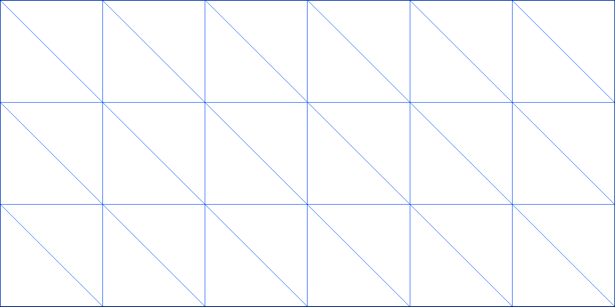

# Assignment 3: Earthquake Visualization

**Due: Friday, November 6, 11:59pm CT**

Visualizations incorporating geospatial data are used and analyzed in many different contexts, including navigating a city (as seen in GPS devices), commercial development, and setting governmental policy. This area also receives a significant amount of research attention. For example, Prof. Vipin Kumar and others at the University of Minnesota are working on visualizing and understanding climate change datasets as part of a [National Science Foundation project](http://climatechange.cs.umn.edu).

For this assignment, you will be working with data from NASA and the USGS to visualize on a globe the locations where earthquakes happened between 1900 and 2007.  Your application will be able to morph between two complementary views of the data, a 2D map view and a 3D globe view, as shown below.



 In this assignment, you will learn to:

- Visualize real-world geographical data on a 3D textured globe.
- Apply textures to 3D objects.
- Algorithmically create a deforming 3D mesh and display it using vertex buffers.
- Define normal vectors and texture coordinates for a sphere.
- Convert from spherical coordinates (latitude and longitude) to 3D Cartesian coordinates.

You can try out the [instructor's implementation](https://csci-4611-fall-2026.github.io/Assignments/Assignment-3/dist) on the course GitHub Pages.  Note that this demo also includes some additional features that are not part of the base assignment requirements, such as the earth rotation, axial tilt, and mouse interactions.

## Repository Setup

We are using GitHub for submission of programming assignments.

**Step 1:** Create your private repository using the following link: https://classroom50.org/CSCI-4611-Fall-2026/csci-4611/assignments/assignment-3/accept

**Step 2:**  The system will then create a new private repository with starter code that is only accessible by you, the instructor, and the TAs. You can then use `git` to check out the code to your local machine. If you prefer a GUI application instead of the command line, then I recommend using [GitHub Desktop](https://github.com/apps/desktop) or Visual Studio Code's integrated source control.

## Prerequisites

To work with this code, you will first need to install [Node.js 24.21.0 LTS](https://nodejs.org/en/download) (or newer) and [Visual Studio Code](https://code.visualstudio.com/). 

## Getting Started

The starter code implements the general structure that we reviewed in lecture.  After cloning your repository, you will need to set up the initial project by pulling the dependencies from the node package manager with:

```
npm install
```

This will create a `node_modules` folder in your directory and download all the dependencies needed to run the project.  Note that this folder is listed in the `.gitignore` file, so it will not be committed to your repository.

You can compile and run a server with:

```
npm run start
```

Your program should open in a web browser automatically.  If not, you can run it by pointing your browser at `http://localhost:5173`.

## Earth and Earthquake Data

We have included multiple scaled-down versions of this Earth texture with the code distributed on the website, since you need a fairly powerful computer to render even the lowest-quality image from the NASA page. In order of decreasing quality, the following images are provided:

- earth-2k.png: 2048×1024 version of image
- earth-1k.png: 1024×512 version of image
- earth-512.png: 512×256 version of image
- earth-256.png: 256×256 version of image

The instructor's implementation uses the 2k version of the texture. If this runs slowly on your computer, you should feel free to use a lower resolution version of the image. The Earth textures are stored in a [equirectangular projection](https://en.wikipedia.org/wiki/Equirectangular_projection), which simply means that the *x* coordinate corresponds directly to longitude and the *y* coordinate corresponds directly to latitude.

The earthquake dataset contains information about the earthquake's magnitude (a measure of severity) and its longitude and latitude. This data has already been loaded into `EarthquakeRecord` objects by the `EarthquakeDatabase` class.  You will be required to display the earthquakes at the correct locations with animations through time. More information on the earthquakes is available in the data file, and if you are interested in potential wizard ideas, you can try to figure out ways to integrate additional data variables into your visualization.

The dataset includes one record with a day value of 0 (`1911-07-00`). For visualization, the loader normalizes this to June 30, 1911, the last day of the preceding month. This is a display convention, not a correction to the original data.

## Program Requirements

You will be required to write the code that displays the Earth on screen and animates it between flat rectangular map and a three-dimensional globe. You will also need to write the code to display the earthquakes on the Earth. The starter code defines a single directional light source at position (10,10,15).  If your normals are defined correctly, you will see some brighter lighting on the top-right portion of the globe, while the bottom-left portion will appear dark.

#### Part 1: Creating the Flat Map Mesh

Complete the `Earth.createMesh()` method to draw a rectangle subdivided into multiple triangles, representing a flat map of the Earth. The flat map mesh should:

- Lie in the *xy* plane.
- Have *x* values ranging from −*π* to *π*.
- Have *y* values ranging from −*π*/2 to *π*/2.
- Be divided into *n* columns horizontally and *m* rows vertically. Note that this will produce (*n*+1)×(*m*+1) vertices and 2×*n*×*m* triangles.  For simplicity, the starter code sets both of these values using the single parameter `meshResolution`. The "Mesh Resolution" GUI control calls `createMesh(meshResolution)` when its value changes, so the mesh will be regenerated at the requested resolution.



The best way to go about this is to start with a small example and then build up from there. We recommend:

- Above is an example with 6 columns and 3 rows. Study how vertices are connected into triangles here.
- Work out the indices on paper by hand for a similar small example, say *n* = 4, *m* = 2. Draw a picture, numbering the vertices and develop your own indices array based on your picture.
- When you have the concept down, recreate your picture in code inside the `Earth.createMesh()` method.  As a demonstration, a rectangle with 4 vertices and 2 triangles has been implemented in the starter code, but all of the values are created manually.  You should create the flat map vertices and indices with nested loops, using the `meshResolution` variable to define the number of rows and columns.
- To check your work, select "Wireframe" from the "Display Mode" dropdown in the app. This draws the edges of each triangle in the mesh so that you can more easily see what is going on, which can be very useful when debugging.
- In computer graphics, vertex normals need to be defined for lighting calculations. For each vertex in the flat map, the normal should be the vector pointing directly outward towards the camera (0, 0, 1).  An example is also provided in the starter code.  Note that the array of normals should be exactly the same length as the vertex array.

#### Part 2: Texturing the Mesh

In the starter code, the Earth texture is loaded and assigned to the example mesh.  However, it won't be displayed until you define the texture coordinates. We will go over this in class, but as a reminder, each vertex requires two coordinates, *u* and *v*, each of which should be a value between 0 and 1.

#### Part 3: Creating the Globe Mesh

Create a second array of vertex positions to draw the Earth as a sphere instead of a rectangle.   You will need to compute a second set of vertices and then assign them to the mesh using the `this.earthMesh.setMorphTargetVertices()` method.

- First, you should complete the `Earth.convertLatLongToSphere() ` method.  If you use this version when creating your mesh, you should end up with sphere geometry instead of a flat map. The mesh connectivity (i.e., the indices that define the triangles) and texture coordinates **do not need to change** when moving from a plane to a sphere. The vertex positions and normals need to change.
- You will need to convert latitude and longitude into the three-dimensional Cartesian coordinates of the corresponding point on the sphere, using the following formulas:
  - **x** = cos(**lat**) × sin(**lon**)
  - **y**= sin(**lat**)
  - **z** = cos(**lat**) × cos(**lon**)


- Be careful to take note that the latitude and longitude in the input file are in degrees, not radians. You can convert them to radians by multiplying by `Math.PI / 180`.

You will also need to compute a second array of normals for the globe mesh.  Because you are now rendering a sphere, you will need to compute new normals to get the lighting on the globe to look good. For each vertex, the normal should be the normalized vector pointing from the center of the sphere (the origin) to the vertex position.  The array of normals should be exactly the same length as the vertex array. You should then store the globe normals using the `this.earthMesh.setMorphTargetNormals()` method.

#### Part 4: Morphing Between the Map and Globe

Smoothly transform the mesh between the flat map and the globe based on user input. The program should start with the Earth displayed as a map. When the user changes the drop down box to "Globe," it should morph into a sphere. If the user changes it back to "Map," it should smoothly morph back to the flat plane.  A GUI event handler is already implemented that sets the value of the `globeMode` boolean variable in the Earth class accordingly. 

- To get started on this, try updating the mesh to instantly change depending on whether the `globeMode` variable is true or false.  You will need to compute a new value for `this.earthMesh.morphAlpha` in the `Earth.update()` method, where morphAlpha=0 will display the flat map, and morphAlpha=1 will display the globe.
- Once you have an instant transition working, try creating a smooth morph. Remember that the `update(deltaTime)` function should be used for any sort of physical simulation or animation. Think about how you can use the elapsed time between frames to make the transition happen gradually.

#### Part 5: Creating the Earthquake Markers

Display on the Earth all the earthquakes that have happened within the past one year of the current visualization time, approximated as 365 days.  The basic structure for this is already implemented; you just need to uncomment a line of code in the `Earth.createEarthquake()` method to start drawing earthquake markers.

-  By default, the earthquake markers are instances of a sphere mesh.  You are free to leave them as spheres or come up with your own custom geometry.
-  The earthquake positions will initially be computed randomly.  Use the `Earth.convertLatLongToPlane()` method to obtain the earthquake positions such that they match the texture (i.e., an earthquake occurring in California must be displayed in the same location as the California of the Earth texture). One way to tell if your mapping is correct is if you see a lot of earthquakes along the "Ring of Fire" in the Pacific Ocean off the coast of Asia.
-  By default, the earthquake markers are identical.  Modify the code so that their appearance varies based on the earthquake data in some meaningful way. For example, the instructor's implementation used `lerp()` functions to adjust the radius (between some predefined minimum and maximum) and color (between yellow to red) of the marker based on its magnitude. 

#### Part 6: Morphing the Earthquake Positions

Similar to the globe geometry, you will need to compute values for the map and globe positions in the `Earth.createEarthquake()` method.  Because they are in latitude and longitude, you can use the same `Earth.convertLatLongToPlane()` and `Earth.convertLatLongToSphere()` methods as before.  

The `EarthquakeMarker` constructor already stores these positions in the `mapPosition` and `globePosition` members, each a `gfx.Vector3`. Add code in `Earth.animateEarthquakes()` that interpolates between these existing members using the same `this.earthMesh.morphAlpha` value, so the marker positions remain synchronized with the earth mesh. The `lerp()` functions described in the "Useful Math" section will provide a convenient way to implement this feature.

## Useful Math

Here are a few mathematical operations that are very common in graphics and may be useful for this assignment:

**Linear interpolation**: One way to blend smoothly between two values *x* and *y* (which could be reals, or vectors, or matrices, etc.) is to define a function in which the output varies continuously from *x* to *y* as a scalar parameter *alpha* goes from 0 to 1. This function is traditionally abbreviated "lerp."

- lerp(*x*, *y*, *alpha*) = *x* + *alpha* × (*y* − *x*)

Thus, for example:

- lerp(*x*, *y*, 0) = *x*

- lerp(*x*, *y*, 1) = *y*

- lerp(*x*, *y*, 0.5) = (*x* + *y*) / 2

GopherGfx provides `lerp()` functions for several of the built-in types, including scalars, vectors, and colors.  For example:

```typescript
// x, y, and alpha are numbers
result = gfx.MathUtils.lerp(x, y, alpha);

// vectors (this function modifies the calling object)
// x and y are Vector3, alpha is a number
someVector.lerp(x, y, alpha);

// colors (this function modifies the calling object)
// x and y are gfx.Color, alpha is a number
someColor.lerp(x, y, alpha);
```

**Clamping**: A concise way to constrain a value to lie in a specified interval [*a*, *b*] is to define a function clamp(*x*, *a*, *b*) which returns *a* if *x* ≤ *a*, returns *b* if *x* ≥ *b*, and returns *x* otherwise.  GopherGfx conveniently provides a clamp function, which would be called as follows:

```typescript
x = gfx.MathUtils.clamp(x, a, b);
```

**Rescaling**: Suppose you have a value *x* in the range [*xmin*, *xmax*], and you want to find the corresponding value in [*ymin*, *ymax*]. Observe that *x* − *xmin* lies in [0, *xmax* − *xmin*], and (*x* − *xmin*)/(*xmax* − *xmin*) lies in [0, 1], so the desired value is:

- *y* = *ymin* + (*ymax* − *ymin*) × (*x* − *xmin*) / (*xmax* − *xmin*)

GopherGfx conveniently provides a rescale function, which would be called as follows:

```typescript
y = gfx.MathUtils.rescale(x, xmin, xmax, ymin, ymax);
```

## Rubric

Functional requirements are graded out of 20 points. Additionally, your submission will be evaluated for code quality (2 points). After your program is submitted, you will also schedule an in-person meeting with a graduate TA for a code understanding check (4 points). The overall assignment grade is therefore worth a total of 26 points.

**Part 1: Creating the Flat Map Mesh** 

- Flat map vertices computed correctly (2)
- Flat map normals computed correctly (2)

- Mesh triangle indices computed correctly (2)

**Part 2: Texturing the Mesh** 

- Mesh texture coordinates computed correctly (2)

**Part 3: Creating the Globe Mesh**

- Globe vertices computed correctly (2)

- Globe normals computed correctly (2)

**Part 4: Morphing Between the Map and Globe**

- Earth mesh smoothly interpolates between the map and globe (2)

**Part 5: Creating the Earthquake Markers**

- Flat map earthquake marker positions computed correctly (2)
- Adjust appearance of each earthquake marker based on its magnitude or some other meaningful metric (2)

**Part 6: Morphing the Earthquake Positions**

- Earthquake marker positions are smoothly interpolated between the map and globe (2)

**Submission**

- To complete the submission, you will need to update your `README.md` file, build your project, and then commit and push both your source code **and** the contents of the `submission` folder to GitHub, as described below.  (-1 point deduction for skipping these steps)

## Wizard Bonus Challenge

All of the assignments in the course will include great opportunities for students to go beyond the requirements of the assignment and do cool extra work. On each assignment, you can earn **one bonus point** for implementing a meaningful new feature to your program. This should involve some original new programming, and should not just be something that can be quickly implemented by copying and slightly modifying existing code. 

Potential opportunities for bonus work in this assignment include:

- The source website for the Earth texture has images for each month of the year (see Acknowledgements below). You could animate between the textures based upon the current time of year.
- We have also included a height text file that contains the elevation and bathymetry data for the Earth on an 8-bit scale (0-255, with sea level at 127, and 0 and 255 representing 8 km below and above sea level, respectively). You could use this data file to visualize the shape of the Earth's surface by displacing mesh vertices along their normals. Note that you may need to increase the mesh resolution to make this look good, which may come at a performance cost.
- You could make the earth rotate, implement some mouse-based interaction, or apply an axial tilt (on average, the earth's axial tilt is about 23.4 degrees). 
- Or, come up with a completely novel idea. Creativity is encouraged!

If you do any wizardly work, please describe it in your `README.md` file so we know what to look for!

## Assignment Submission

When you have finished the assignment, you should complete the missing information in your `README.md` file. Then, you will need to run the following command:

```
npm run submit
```

This compiles your TypeScript program into a JavaScript bundle that will be placed in the `submission` folder. **To complete your submission, you should commit your source code (`src` folder) and compiled build (`submission` folder), then push to GitHub.**

The push to GitHub will trigger a server-side workflow that will automatically deploy your build as a website on GitHub pages. Note that you may need to wait a couple minutes for the deployment to become active. Make sure to test everything by pointing your web browser at the GitHub pages URL for your repository:

```
https://csci-4611-fall-2026.github.io/your-repo-name-here
```

Note that the published JavaScript bundle code generated by the TypeScript compiler has been obfuscated so that it is not human-readable. So, you can feel free to send this link to other students, friends, and family to show off your work!

## Schedule a Code Understanding Check

After you submit your code, you can schedule a meeting with a graduate TA for the code understanding check. Instructions will be posted closer to the assignment submission deadline.

## Acknowledgments

Earthquake data was obtained from [USGS](http://earthquake.usgs.gov/). This data is in the public domain. Credit: U.S. Geological Survey Department of the Interior/USGS.

The Earth texture was obtained from [NASA Visible Earth](http://visibleearth.nasa.gov/view_cat.php?categoryID=1484). This data is in the public domain. Credit: NASA Earth Observatory.

The star background image was created by Jeremy Perkins on [Unsplash](https://unsplash.com/photos/uhjiu8FjnsQ).

Assignment developed by Daniel Keefe and TAs 2012, 2014.

Ported to MinGfx and additional refinements by Daniel Keefe and TAs 2018-2021.

Ported to GopherGfx and additional refinements by Evan Suma Rosenberg 2022-2024.

## License

Public distribution of assignment source code outside the class is **prohibited**. If you want to showcase your work to potential employers, then you may distribute the link to the compiled build on GitHub Pages or share the source code with them **privately**.
